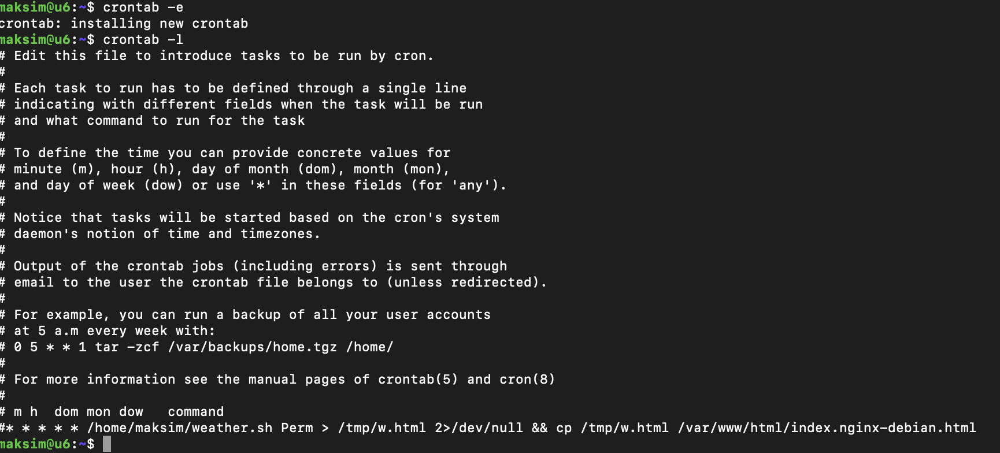
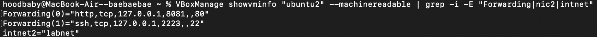
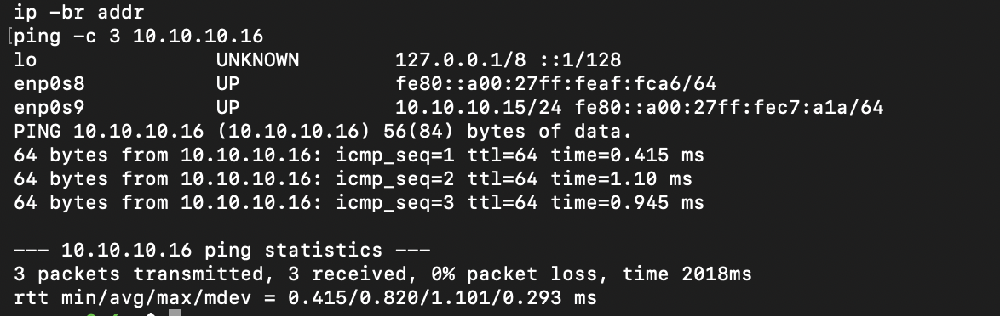
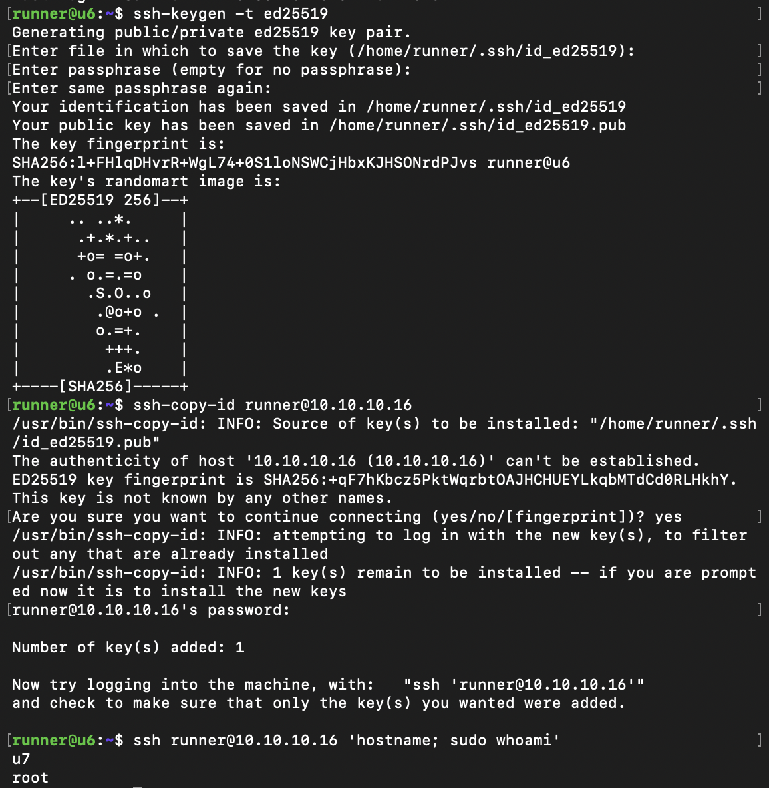
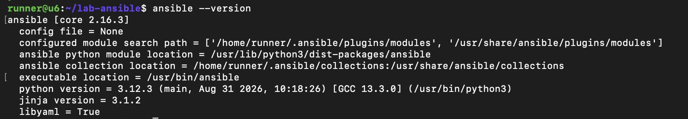
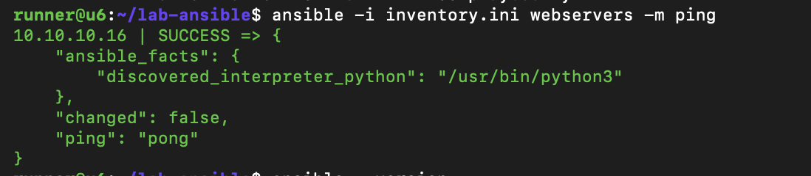
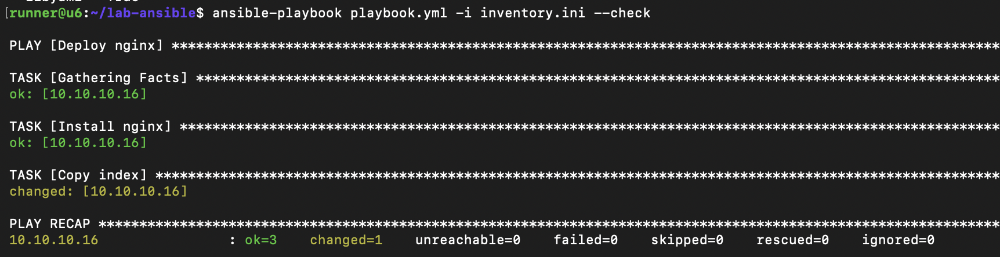
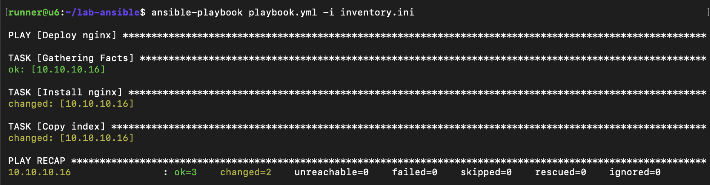
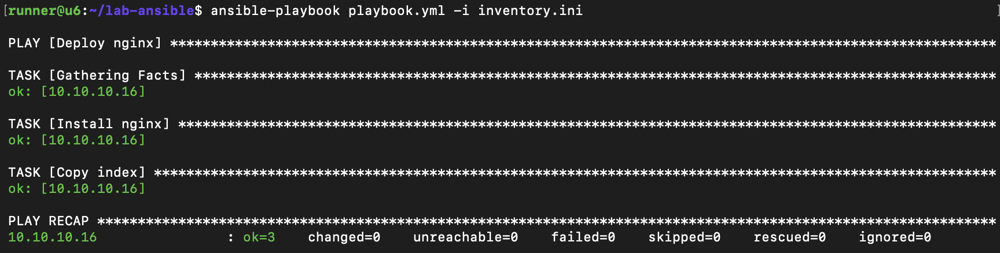
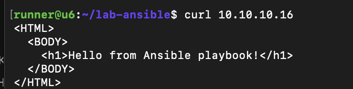

# Лабораторная П04. Деплой веб-сервера с помощью Ansible

## Задание
Сделать Ansible-плейбук, который установит на целевую машину nginx и скопирует на неё индексный файл. Для этого нужны две виртуальные машины: управляющая (control node) с Ansible и целевая (managed node).

## Окружение
- Хост: macOS (Apple Silicon), гипервизор VirtualBox
- VM-1 `u6` (control node), VM-2 `u7` (managed node): Ubuntu Server 24.04 (arm64)
- Ansible установлен на VM-1 из репозитория Ubuntu (`apt install ansible`)
- Пользователь для работы: `runner` (sudo без пароля)

### Схема
| | VM-1 (control node) | VM-2 (managed node) |
|---|---|---|
| Имя в VirtualBox | `ubuntu` | `ubuntu2` |
| Hostname | `u6` | `u7` |
| Адрес во внутренней сети `labnet` | `10.10.10.15` | `10.10.10.16` |
| Проброс SSH на хосте | `127.0.0.1:2222 → 22` | `127.0.0.1:2223 → 22` |
| Проброс HTTP на хосте | нет | `127.0.0.1:8081 → 80` |

### Отличия от методички
- Вместо «Сети NAT» VirtualBox использована **внутренняя сеть `labnet`** (второй адаптер у обеих VM), так как на VirtualBox для Apple Silicon сеть NAT работает нестабильно. Адреса соответственно `10.10.10.15` и `10.10.10.16` вместо `10.0.2.15` и `10.0.2.16`. Первый адаптер (NAT) остался для доступа в интернет и проброса портов.
- Порты хоста у VM-2 другие (2223 и 8081), чтобы не конфликтовать с VM-1.
- В задаче копирования файла права `0644` вместо `0666`, так безопаснее.

## Файлы репозитория
- [`playbook.yml`](playbook.yml): плейбук установки nginx и копирования страницы
- [`inventory.ini`](inventory.ini): инвентарь с адресом VM-2
- [`index.html`](index.html): шаблон индексной страницы
- `screenshots/`: скриншоты

## 0. Отключение скрипта из прошлой работы
Задание cron со скриптом `weather.sh` закомментировано (`crontab -e`), чтобы он не перезаписывал страницу nginx.



## 1. Вторая виртуальная машина
VM-2 создана клонированием VM-1 (связанный клон со снимком состояния, новые MAC-адреса сгенерированы автоматически). Обеим VM добавлен второй сетевой адаптер типа «Внутренняя сеть» с именем `labnet`. У VM-2 настроен проброс портов 2223 → 22 и 8081 → 80.



На VM-2 заданы имя `u7` (`hostnamectl set-hostname`) и статический адрес `10.10.10.16/24` на втором интерфейсе (`/etc/netplan/60-labnet.yaml`), на VM-1 адрес `10.10.10.15/24`. Связь между машинами проверена командой `ping`.



## 2. SSH-ключ и пользователь runner
Пользователь `runner` с правами sudo без пароля на VM-2 появился при клонировании (он уже был на VM-1 с прошлых работ). На VM-1 под `runner` создан ключ ed25519 (`ssh-keygen -t ed25519`) и скопирован на VM-2 командой `ssh-copy-id runner@10.10.10.16`. Проверка `ssh runner@10.10.10.16 'hostname; sudo whoami'` вернула `u7` и `root` без запроса пароля, то есть вход по ключу и sudo без пароля работают. Приватный ключ в репозиторий не добавлялся.



## 3. Установка Ansible и подготовка файлов
На VM-1 установлен Ansible (`sudo apt install ansible`).



Создан каталог `~/lab-ansible` с файлами `inventory.ini`, `playbook.yml` и `index.html`. Связь с управляемым узлом проверена модулем `ping`: ответ `pong` означает, что Ansible подключился по SSH и смог выполнить Python-модуль на VM-2.

```bash
ansible -i inventory.ini webservers -m ping
```



### inventory.ini
```ini
[webservers]
10.10.10.16
```

### playbook.yml
```yaml
---
- name: Deploy nginx
  hosts: webservers
  remote_user: runner
  become: yes
  become_method: sudo

  tasks:
  - name: Install nginx
    ansible.builtin.apt:
      name: nginx
      state: latest
      update_cache: yes

  - name: Copy index
    ansible.builtin.copy:
      src: ./index.html
      dest: /var/www/html/index.nginx-debian.html
      owner: root
      group: root
      mode: '0644'
```
Плейбук подключается как `runner` (`remote_user`), повышает права через sudo (`become`), устанавливает nginx модулем `apt` и копирует `index.html` в каталог сайта nginx модулем `copy`.

### index.html
```html
<HTML>
  <BODY>
    <h1>Hello from Ansible playbook!</h1>
  </BODY>
</HTML>
```

## 4. Выполнение плейбука
**Тестовый прогон** (`--check`) не вносит изменений и показывает, что изменилось бы. Ошибок нет (`failed=0`, `unreachable=0`).

```bash
ansible-playbook playbook.yml -i inventory.ini --check
```



**Боевой прогон.** Обе задачи отработали (`changed=2`, `failed=0`). Задача установки показала `changed`, потому что для nginx указано `state: latest`: пакет был обновлён до последней версии из репозитория после `update_cache`. В тестовом режиме `apt` не всегда предсказывает такое обновление, поэтому там задача была `ok`.

```bash
ansible-playbook playbook.yml -i inventory.ini
```



**Повторный прогон** демонстрирует идемпотентность: система уже в нужном состоянии, поэтому изменений нет (`changed=0`).



## 5. Проверка результата
С VM-1 запрос к новому веб-серверу:

```bash
curl 10.10.10.16
```



С хоста страница открывается в браузере по адресу `http://127.0.0.1:8081` (проброс 8081 → 80 на VM-2):


## Выводы
Развёрнута пара виртуальных машин (управляющая и целевая), настроен доступ по SSH-ключу и sudo без пароля, установлен Ansible. Написан плейбук, который устанавливает nginx и разворачивает индексную страницу на целевой машине.
